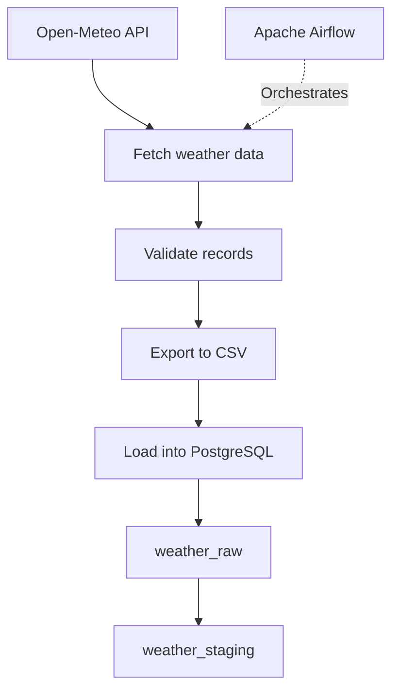

# European Weather Data Pipeline

An automated data pipeline that collects current weather data for European cities, validates the records, exports them to CSV, and loads them into PostgreSQL.

## Project Overview

This project demonstrates an end-to-end ETL pipeline built with Apache Airflow, Python, the Open-Meteo API, and PostgreSQL.

### Cities
- Berlin
- Paris
- Rome

### Data Collected
- Temperature (°C)
- Relative humidity (%)
- Wind speed (km/h)
- Observation timestamp

## Architecture



## Pipeline Steps

1. **Extract** — Retrieve current weather data from Open-Meteo for Berlin, Paris, and Rome.
2. **Validate** — Check required fields and validate temperature, humidity, and wind speed values.
3. **Export** — Write the collected records to a CSV file.
4. **Load raw data** — Insert records into the `weather_raw` PostgreSQL table.
5. **Create staging data** — Load records into `weather_staging` for downstream analysis.

Duplicate records are handled using database conflict rules.

## Technologies

- Python
- Apache Airflow
- PostgreSQL
- Open-Meteo API
- CSV
- Docker
- DBeaver

## Scheduling

The Airflow DAG is configured to run daily at 06:00 according to the Airflow timezone.

DAG ID: `european_weather_pipeline`

## Project Structure

```text
airflow/
├── dags/
│   ├── european_weather_pipeline.py
│   └── weather_pipeline_script.py
├── data/
│   └── weather.csv          # Generated at runtime; not committed
├── .env                     # Local secrets; not committed
├── .gitignore
└── README.md
```

## Configuration and Security

Database credentials are provided through environment variables.

Before running the project, configure the required environment variables locally. Never commit `.env` files, database passwords, or other secrets to GitHub.

## What This Project Demonstrates

- API data extraction
- Data validation
- ETL pipeline design
- Workflow orchestration with Airflow
- PostgreSQL data loading
- Separation of raw and staging data
- Basic secret management with environment variables
